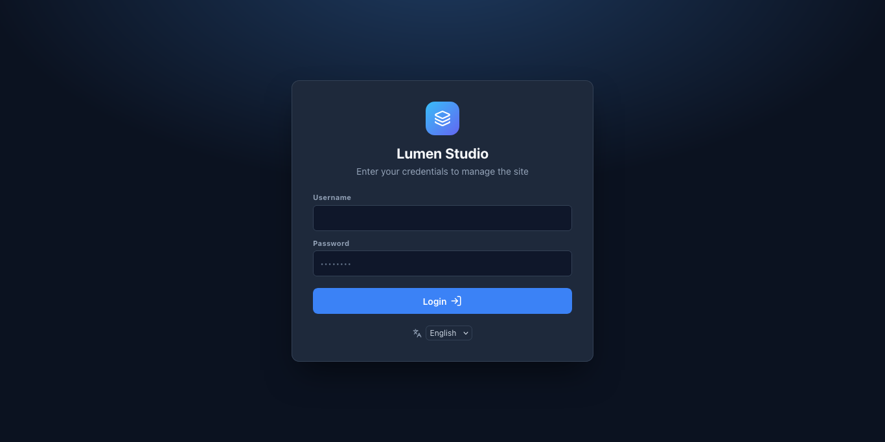

# 1. Install CanvasCore

CanvasCore is a PHP application with a built-in SQLite database: there is no MySQL to create and nothing to compile on the server.

## What your hosting needs

- **PHP 8.0 or newer** (8.2 or 8.3 is a good choice), with the extensions `pdo_sqlite`, `dom`, `json` and `session` (all standard).
- Recommended: `zip` (backups, updates, template library), `sodium` (checks the signatures of updates), `gd` or `imagick` (smaller copies of your images), `curl`, `mbstring`.
- Apache or LiteSpeed (most shared hosting) works with no configuration. On Nginx you add a few rules: see the [Administrator Guide](../manuals/ADMIN-GUIDE.md#42-nginx).
- A domain or subdomain with HTTPS.

The installer checks all of this for you and says what is missing before it lets you install.

## Way 1: the setup wizard (works everywhere)

1. Download `canvascore-<version>.zip` from the [releases page](https://github.com/sputlab/canvascore/releases/latest).
2. Upload it to the folder your domain serves (often `public_html`) with your hosting file manager or FTP, and **extract** it there. You now have a folder `canvascore-admin/`.
3. Open `https://your-domain/canvascore-admin/install.php`.
4. The page lists your server's capabilities. Red items must be fixed first; yellow ones are advice.
5. **Setup key.** The wizard wrote a key into a file called `install-key.txt` in the data folder (the page shows where). Open that file with the file manager and paste its content. This proves you control the server, so nobody who finds a freshly uploaded site can install it before you.
6. Fill in the site name, the site address, your administrator username (not `admin`) and a password of at least 8 characters, and optionally a ready-made home page.
7. **Install CanvasCore**, then delete `install.php` when the wizard offers to.



## Way 2: one click with Softaculous

If your hosting panel has **Softaculous**, look for CanvasCore in its list. If it is not there yet, a package is attached to every release (`canvascore-<version>-softaculous.zip`): your host can add it, or on your own server use *Admin › Add Custom Script*. The form asks for the site name, a home page template and your administrator account; nothing else.

## Way 3: the command line

For a server you manage yourself:

```bash
CC_ADMIN_PASS='a-long-password' php canvascore-admin/install-cli.php \
  --site-name="My site" --admin-user=maria --admin-email=maria@example.com --site-url=https://www.example.com
```

The password comes from the environment (or `--admin-pass-stdin`), never as an argument. `--json` gives a machine-readable answer, `--starter=<id>` makes a first page, `--delete-installer` removes `install.php`.

## First sign-in

Open `https://your-domain/canvascore-admin/`, sign in, and you land on the page list. The language of the editor is chosen under the sign-in form or at the bottom of the sidebar (English or Italian).

**Next:** [deploy on shared hosting](02-shared-hosting.md) for the details of a cPanel account, or go straight to [your first site](03-first-site.md).
