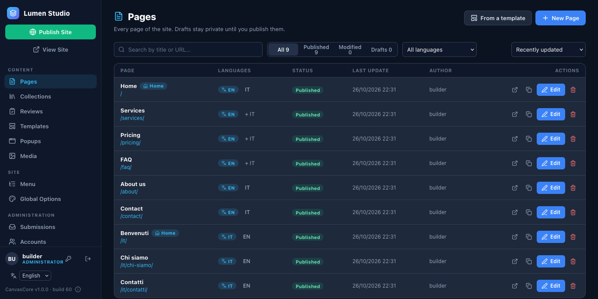
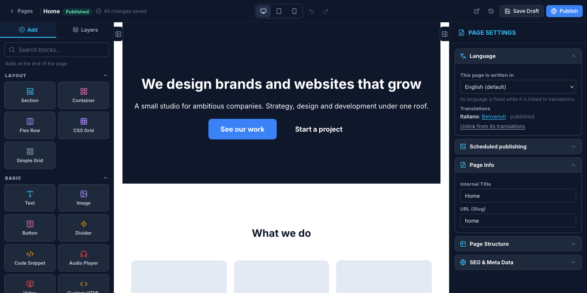
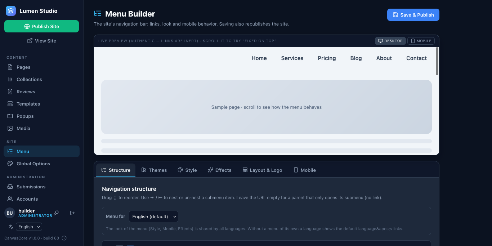
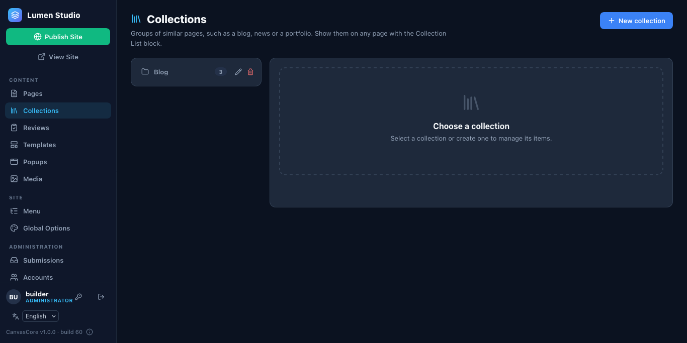

# 3. Build your first site

## Pages from templates

Click **Pages** in the sidebar. The list shows every page with its address, language and status (Draft, Published, Modified).

**New Page** makes a blank page; **From a template** starts from a ready-made one (landing page, about, services, pricing, FAQ, contact, a portfolio, a restaurant…). Templates are drafts: nothing is online until you publish.

## The editor

Open a page with **Edit**.

- **Add** (left) lists the blocks: text, images, buttons, heroes, galleries, forms, pricing, FAQs, maps and more. Click one to add it at the end, or drag it where you want it. **Layers** shows the page as a tree.
- Click a block on the canvas to select it. The panel on the right has three tabs: **Content** (what it says), **Style** (spacing, colors, typography per device) and **Advanced** (animations and effects).
- Click text on the canvas to type in place. The top bar switches between computer, tablet and phone views and has Undo and Redo.
- **Save Draft** keeps your work private. **Publish** makes the page live.

Your unsaved work is backed up in your browser, and every saved version of a page is kept in its history (the clock icon).

## The menu

**Menu** in the sidebar builds the navigation: add items, drag them to reorder, nest them for drop-downs, and pick a look (colors, effects, sticky bar, logo).

## Site-wide settings

**Global Options** holds the site name and address, brand color, fonts, the global header and footer, the cookie banner and the announcement bar, and redirects.

## Publish

**Publish Site** (top of the sidebar) writes the pages as plain HTML files next to `canvascore-admin/`. That is what visitors get: fast static pages with no database behind them. Use **View Site** to look at it.

## A blog

**Collections** holds lists of things that are not pages: blog posts, team members, products. Make a collection (for example *Blog*), add items, and show them on any page with the **Collection List** block. Each item gets its own page.

**Next:** [manage the site](04-manage.md).
