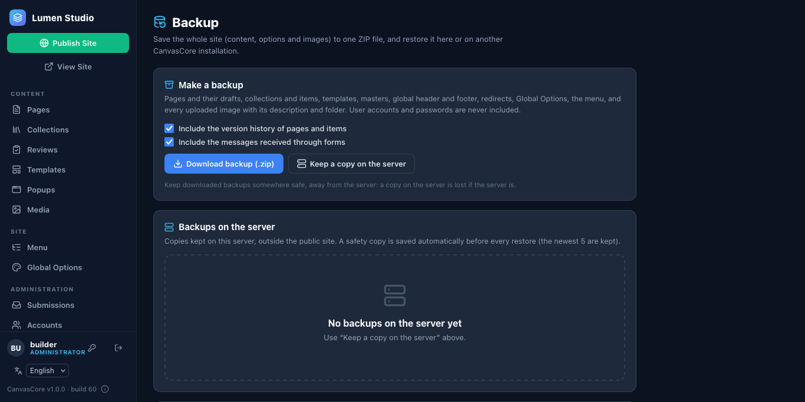
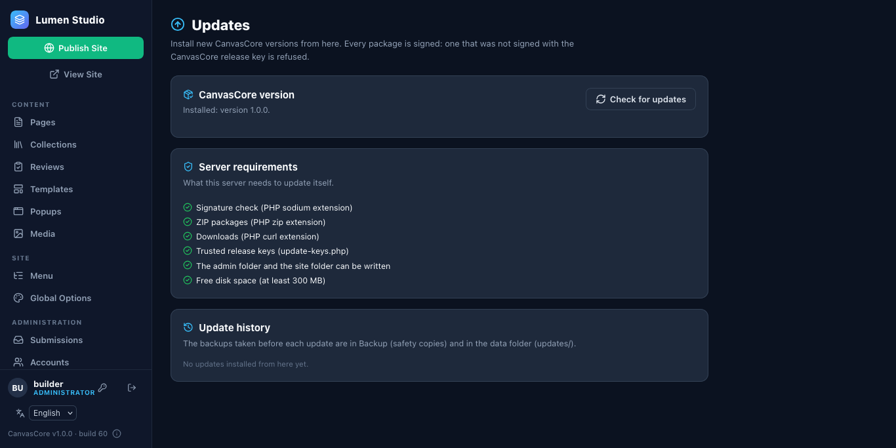
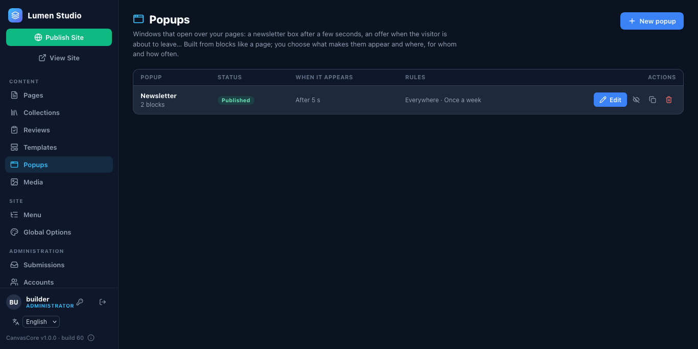
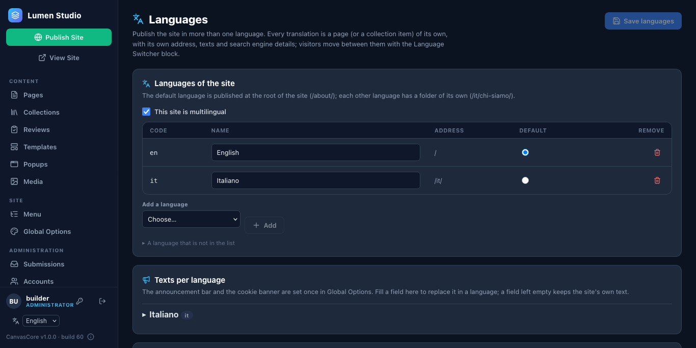

# 4. Manage the site

## People and roles

**Administration › Accounts** adds people. A role says what they can do:

| Role | Can |
| --- | --- |
| **Administrator** | everything: accounts, backups, updates, custom code |
| **Editor** | all content; publishes directly |
| **Author** | writes their own pages and items and submits them for review |
| **Reviewer** | approves what authors submit, or sends it back |

A new person gets a temporary password and chooses their own at the first sign-in. A collection can be limited to chosen people (**Collections › Who can work here**).

## Backups

**Administration › Backup** saves the whole site in one ZIP: pages and drafts, collections, templates, header and footer, redirects, options, the menu and every uploaded image.

- **Download backup (.zip)** for a copy on your computer; **Keep a copy on the server** for a quick one.
- **Restore** puts a backup back (the same site or a new one). Before a restore, a safety copy of the current site is saved, so it can be undone.
- Make one before an update and before big changes. Also keep your hosting's own backup of the data folder.

## Updates

**Administration › Updates › Check for updates.** When a new version exists, **Update to X** downloads it, checks its signature, makes a backup, swaps the files and checks the site; if anything fails it rolls back. The 1.x line never breaks your content: updating within it is always safe.

## Pictures and files

**Media** is the library: upload images (smaller copies are made automatically), organise them in folders, crop and set a focal point, and see where each image is used. Moving an image to another folder never breaks a page.

## Popups

**Popups** builds windows that open over your pages: a newsletter box after a few seconds, an offer when the visitor is about to leave. Pick the trigger (time, scroll, exit intent, a link) and the rules (which pages, devices, new or returning visitors, how often), then publish the popup and the site.

## A second language

**Administration › Languages**: tick *This site is multilingual*, add the languages and choose the default one. In **Pages**, a **+ IT** button makes a draft translation of a page; the language switcher block (put it in the global header) lets visitors move between them, and search engines get `hreflang` links.

## Integrations

**Administration › Integrations** connects forms to a webhook, Mailchimp or Brevo, and adds Google Analytics, Plausible or Matomo (with consent) and Stripe payment links. Keys are stored apart from the settings and never shown again.

## Good habits

- Publish after changing the menu, header, footer, languages or popups: they are written into every page at publish time.
- Keep an eye on **Administration › Submissions** for form messages.
- Use **Version history** (clock icon in the editor) to get an earlier version of a page back.

**Next:** [run a public demo](05-public-demo.md).
