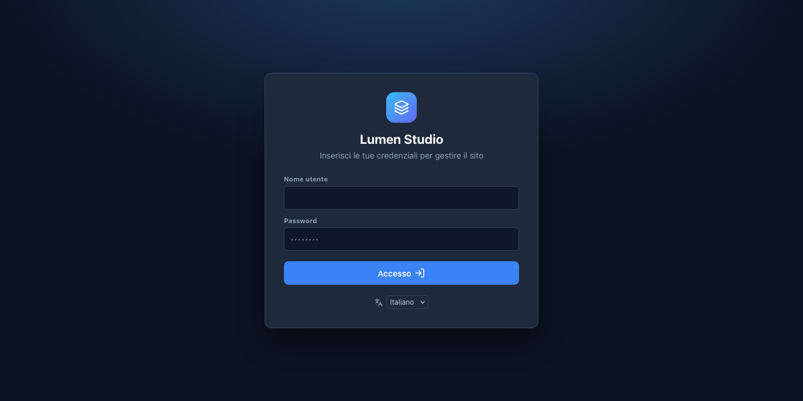

# 1. Installa CanvasCore

CanvasCore è un'applicazione PHP con un database SQLite integrato: non c'è nessun database MySQL da creare e niente da compilare sul server.

## Cosa serve al tuo hosting

- **PHP 8.0 o più recente** (8.2 o 8.3 sono un'ottima scelta), con le estensioni `pdo_sqlite`, `dom`, `json` e `session` (tutte standard).
- Consigliate: `zip` (backup, aggiornamenti, libreria dei modelli), `sodium` (verifica le firme degli aggiornamenti), `gd` o `imagick` (copie più leggere delle tue immagini), `curl`, `mbstring`.
- Apache o LiteSpeed (la maggior parte degli hosting condivisi) funzionano senza configurazione. Con Nginx devi aggiungere qualche regola: vedi l'[Administrator Guide](../../manuals/ADMIN-GUIDE.md#42-nginx) (in inglese).
- Un dominio o sottodominio con HTTPS.

Il programma di installazione controlla tutto questo per te e ti dice cosa manca prima di lasciarti installare.

## Modo 1: la procedura guidata (funziona ovunque)

1. Scarica `canvascore-<version>.zip` dalla [pagina delle release](https://github.com/sputlab/canvascore/releases/latest).
2. Caricalo nella cartella servita dal tuo dominio (spesso `public_html`) con il file manager dell'hosting o via FTP, ed **estrailo** lì. Ora hai una cartella `canvascore-admin/`.
3. Apri `https://your-domain/canvascore-admin/install.php`.
4. La pagina elenca le capacità del tuo server. Le voci rosse vanno sistemate prima; quelle gialle sono consigli.
5. **Chiave di installazione.** La procedura ha scritto una chiave in un file chiamato `install-key.txt` nella cartella dei dati (la pagina ti mostra dove). Apri quel file con il file manager e incollane il contenuto. Così dimostri di avere il controllo del server, e nessuno che trovi un sito appena caricato può installarlo prima di te.
6. Inserisci il nome del sito, l'indirizzo del sito, il tuo nome utente da amministratore (non `admin`) e una password di almeno 8 caratteri e, se vuoi, una home page già pronta.
7. **Installa CanvasCore**, poi elimina `install.php` quando la procedura te lo propone.



## Modo 2: un clic con Softaculous

Se il pannello del tuo hosting ha **Softaculous**, cerca CanvasCore nel suo elenco. Se non c'è ancora, a ogni release è allegato un pacchetto (`canvascore-<version>-softaculous.zip`): il tuo hosting può aggiungerlo oppure, su un server tuo, usa *Admin › Add Custom Script*. Il modulo chiede il nome del sito, un modello per la home page e il tuo account da amministratore; nient'altro.

## Modo 3: la riga di comando

Per un server che gestisci tu:

```bash
CC_ADMIN_PASS='a-long-password' php canvascore-admin/install-cli.php \
  --site-name="My site" --admin-user=maria --admin-email=maria@example.com --site-url=https://www.example.com
```

La password arriva dall'ambiente (o da `--admin-pass-stdin`), mai come argomento. `--json` dà una risposta leggibile da un programma, `--starter=<id>` crea una prima pagina, `--delete-installer` rimuove `install.php`.

## Primo accesso

Apri `https://your-domain/canvascore-admin/`, entra e ti ritrovi nell'elenco delle pagine. La lingua dell'editor si sceglie sotto il modulo di accesso o in fondo alla barra laterale (inglese o italiano).

**Prossimo passo:** [pubblica su un hosting condiviso](02-shared-hosting.md) per i dettagli di un account cPanel, oppure vai direttamente al [tuo primo sito](03-first-site.md).
