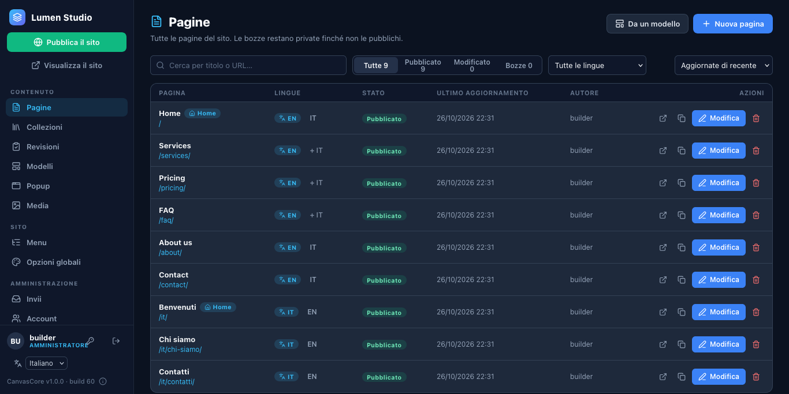
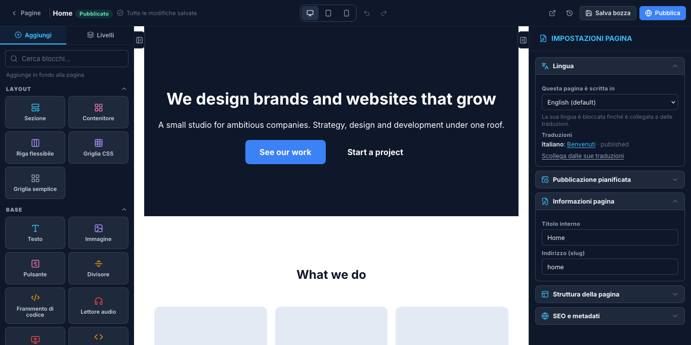
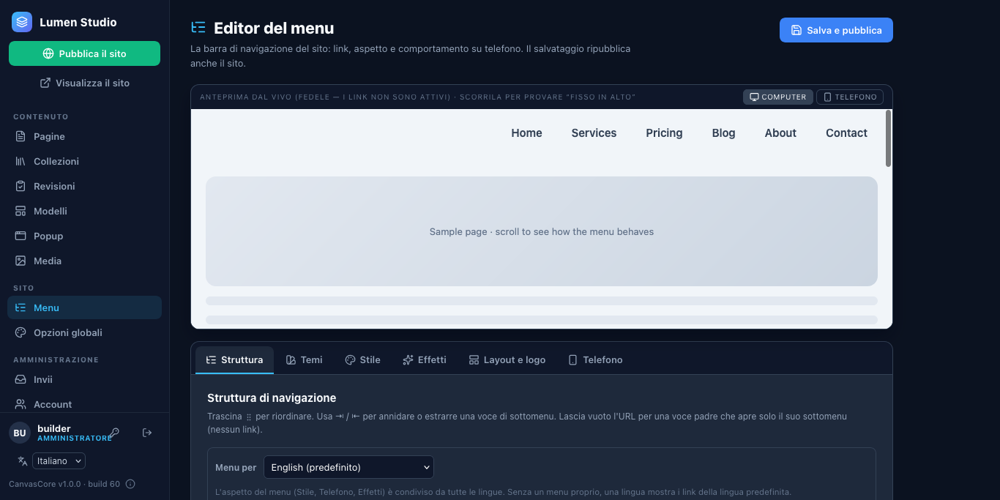
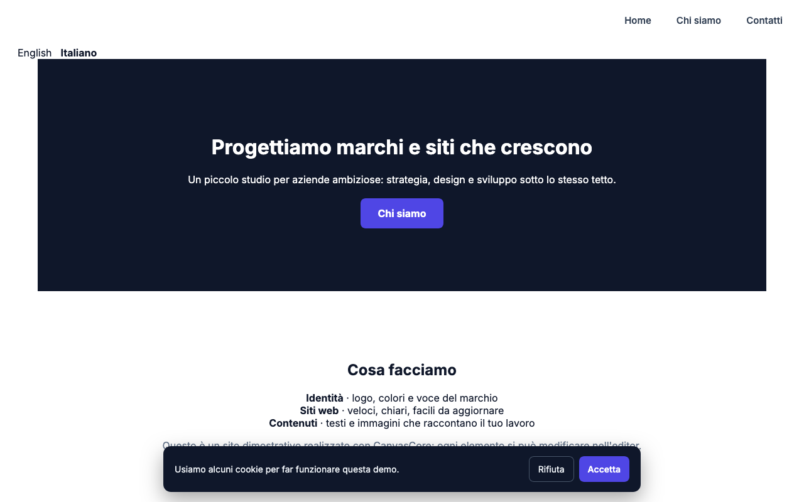
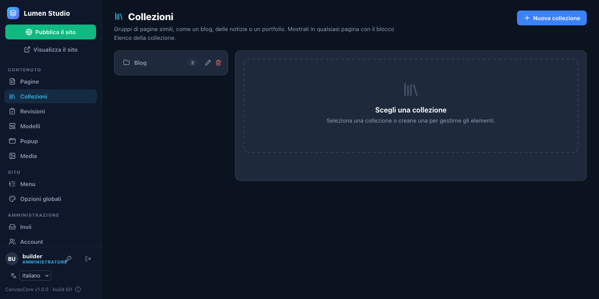

# 3. Crea il tuo primo sito

## Pagine dai modelli

Fai clic su **Pagine** nella barra laterale. L'elenco mostra ogni pagina con il suo indirizzo, la lingua e lo stato (Bozza, Pubblicata, Modificata).

**Nuova pagina** crea una pagina vuota; **Da un modello** parte da una pagina già pronta (landing page, chi siamo, servizi, prezzi, FAQ, contatti, un portfolio, un ristorante…). I modelli sono bozze: niente va online finché non pubblichi.

## L'editor

Apri una pagina con **Modifica**.

- **Aggiungi** (a sinistra) elenca i blocchi: testo, immagini, pulsanti, hero, gallerie, moduli, prezzi, FAQ, mappe e altro. Fai clic su uno per aggiungerlo in fondo, oppure trascinalo dove vuoi. **Livelli** mostra la pagina come un albero.
- Fai clic su un blocco nell'area di lavoro per selezionarlo. Il pannello a destra ha tre schede: **Contenuto** (cosa dice), **Stile** (spaziature, colori, tipografia per dispositivo) e **Avanzate** (animazioni ed effetti).
- Fai clic su un testo nell'area di lavoro per scrivere direttamente lì. La barra in alto passa tra le viste computer, tablet e telefono e ha Annulla e Ripeti.
- **Salva bozza** tiene il tuo lavoro privato. **Pubblica** mette la pagina online.

Il lavoro non salvato viene conservato nel tuo browser, e ogni versione salvata di una pagina resta nella sua cronologia (l'icona dell'orologio).

## Il menu

**Menu** nella barra laterale costruisce la navigazione: aggiungi le voci, trascinale per riordinarle, annidale per i menu a tendina e scegli un aspetto (colori, effetti, barra fissa, logo).

## Impostazioni di tutto il sito

**Opzioni globali** contiene il nome e l'indirizzo del sito, il colore del marchio, i caratteri, l'intestazione e il piè di pagina globali, il banner dei cookie e la barra degli annunci, e i reindirizzamenti.

## Pubblica

**Pubblica il sito** (in cima alla barra laterale) scrive le pagine come semplici file HTML accanto a `canvascore-admin/`. È quello che ricevono i visitatori: pagine statiche veloci senza un database dietro. Usa **Vedi il sito** per guardarlo.

## Un blog

**Collezioni** contiene elenchi di cose che non sono pagine: articoli del blog, membri del team, prodotti. Crea una collezione (per esempio *Blog*), aggiungi degli elementi e mostrali in qualsiasi pagina con il blocco **Elenco della collezione**. Ogni elemento ha la sua pagina.

**Prossimo passo:** [gestisci il sito](04-manage.md).
