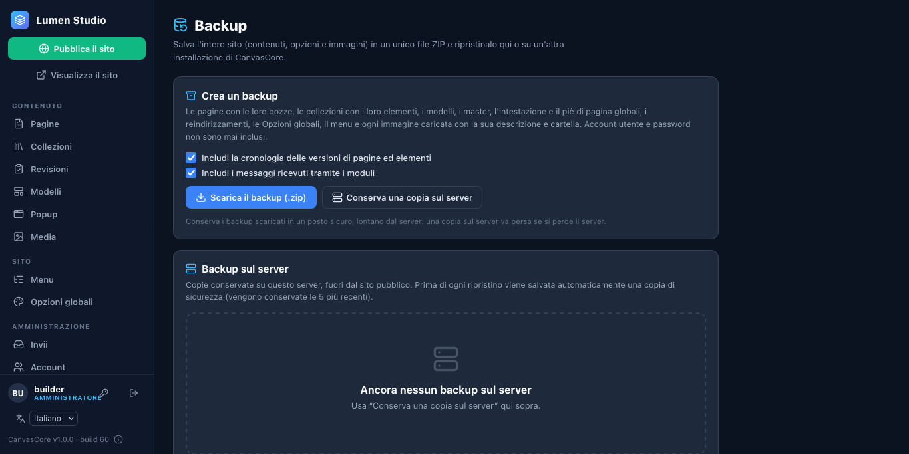
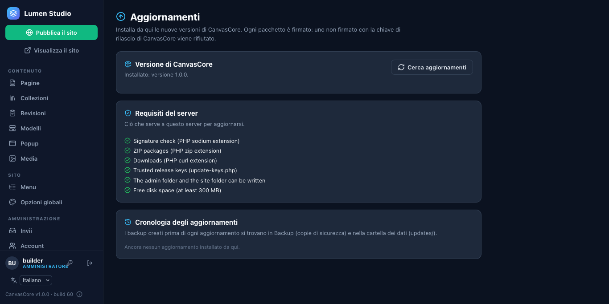
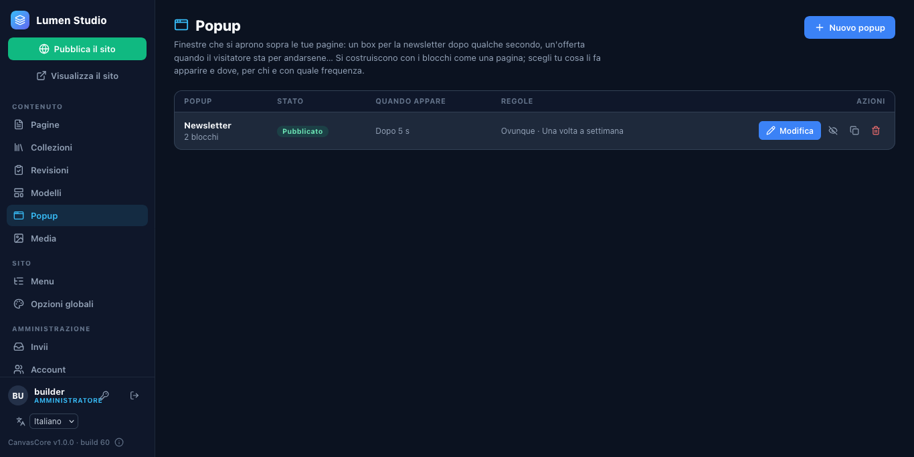
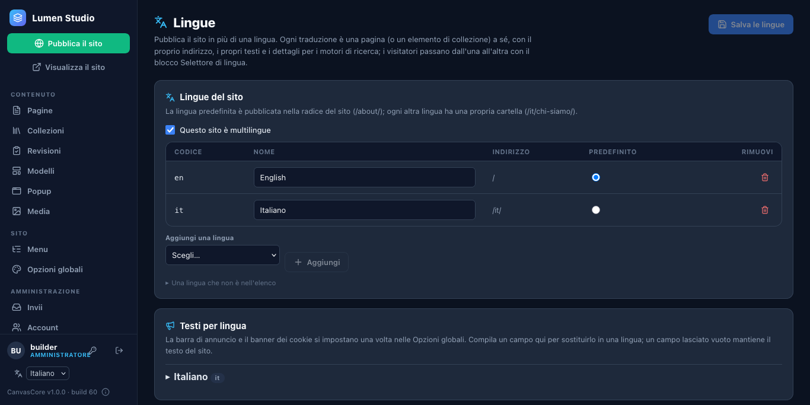

# 4. Gestisci il sito

## Persone e ruoli

**Amministrazione › Account** aggiunge le persone. Un ruolo dice cosa possono fare:

| Ruolo | Può |
| --- | --- |
| **Amministratore** | tutto: account, backup, aggiornamenti, codice personalizzato |
| **Editor** | tutti i contenuti; pubblica direttamente |
| **Autore** | scrive le proprie pagine e i propri elementi e li invia per la revisione |
| **Revisore** | approva quello che inviano gli autori, oppure lo rimanda indietro |

Una nuova persona riceve una password temporanea e sceglie la propria al primo accesso. Una collezione può essere riservata a persone scelte (**Collezioni › Chi può lavorare qui**).

## Backup

**Amministrazione › Backup** salva l'intero sito in un unico ZIP: pagine e bozze, collezioni, modelli, intestazione e piè di pagina, reindirizzamenti, opzioni, il menu e ogni immagine caricata.

- **Scarica il backup (.zip)** per una copia sul tuo computer; **Tieni una copia sul server** per una copia veloce.
- **Ripristina** rimette a posto un backup (sullo stesso sito o su uno nuovo). Prima di un ripristino viene salvata una copia di sicurezza del sito attuale, così puoi tornare indietro.
- Fanne uno prima di un aggiornamento e prima dei cambiamenti importanti. Tieni anche il backup della cartella dei dati fatto dal tuo hosting.

## Aggiornamenti

**Amministrazione › Aggiornamenti › Cerca aggiornamenti.** Quando c'è una nuova versione, **Aggiorna a X** la scarica, ne verifica la firma, fa un backup, sostituisce i file e controlla il sito; se qualcosa va storto torna indietro. La serie 1.x non rompe mai i tuoi contenuti: aggiornare al suo interno è sempre sicuro.

## Immagini e file

**Media** è la libreria: carica le immagini (le copie più leggere vengono create in automatico), organizzale in cartelle, ritagliale e imposta un punto focale, e vedi dove viene usata ogni immagine. Spostare un'immagine in un'altra cartella non rompe mai una pagina.

## Popup

**Popup** crea finestre che si aprono sopra le tue pagine: un box per la newsletter dopo qualche secondo, un'offerta quando il visitatore sta per andarsene. Scegli l'attivazione (tempo, scorrimento, intenzione di uscita, un link) e le regole (quali pagine, dispositivi, visitatori nuovi o di ritorno, ogni quanto), poi pubblica il popup e il sito.

## Una seconda lingua

**Amministrazione › Lingue**: spunta *Questo sito è multilingue*, aggiungi le lingue e scegli quella predefinita. In **Pagine**, un pulsante **+ IT** crea una bozza di traduzione di una pagina; il blocco del selettore di lingua (mettilo nell'intestazione globale) permette ai visitatori di passare da una lingua all'altra, e i motori di ricerca ricevono i link `hreflang`.

## Integrazioni

**Amministrazione › Integrazioni** collega i moduli a un webhook, a Mailchimp o a Brevo, e aggiunge Google Analytics, Plausible o Matomo (con consenso) e i link di pagamento Stripe. Le chiavi sono salvate separatamente dalle impostazioni e non vengono mai più mostrate.

## Buone abitudini

- Pubblica dopo aver cambiato il menu, l'intestazione, il piè di pagina, le lingue o i popup: vengono scritti in ogni pagina al momento della pubblicazione.
- Tieni d'occhio **Amministrazione › Invii** per i messaggi dei moduli.
- Usa **Cronologia delle versioni** (l'icona dell'orologio nell'editor) per recuperare una versione precedente di una pagina.

**Prossimo passo:** [metti online una demo pubblica](05-public-demo.md).
